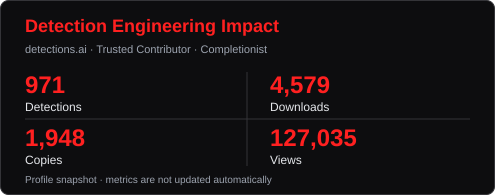
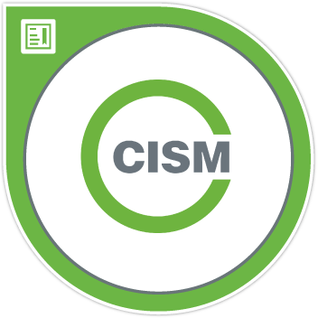
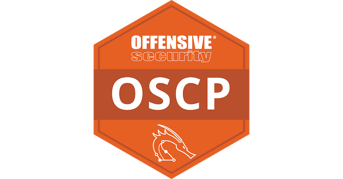
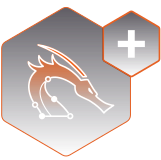
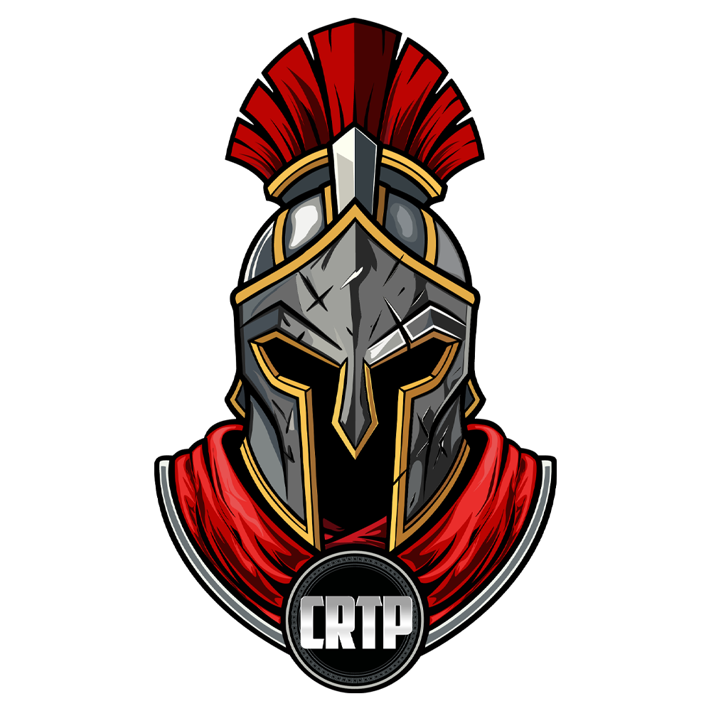
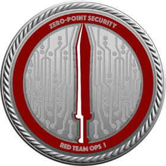
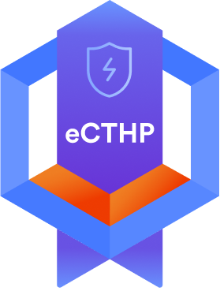

# Daniel Jeremiah
### Senior Cybersecurity Specialist · PhD Researcher at APU
**Defending systems. Investigating threats. Researching AI for cybersecurity.**

    

Senior cybersecurity specialist and PhD researcher working at the intersection of **threat detection, adversarial machine learning, and generative AI**. Pursuing a PhD in Computing & Technology at **Asia Pacific University of Technology & Innovation (APU)**.

<h2 align="center">Open-source Activity & Impact</h2>

<table align="center" width="100%" cellspacing="0" cellpadding="0">
<tr>
<td width="50%" valign="top">
 

</td>
<td width="50%" valign="top">
 
 

</td>
</tr>
</table>

<h2 align="center">Cybersecurity & AI Expertise</h2>

      

      

**In practice:** KQL · Elastic SIEM · Velociraptor · SOAR · VAPT · Adversarial simulations

<h2 align="center">Research & Publications</h2>

| Year | Publication | Venue |
| :---: | :--- | :--- |
| 2026 | [TAH-GAN: Time-Aware Hybrid Generative Adversarial Network for Robust Android Malware Evasion](https://assets-eu.researchsquare.com/files/rs-10821022/v1_covered_a8be9867-845b-49e0-a254-3a58a55df434.pdf?c=1788797150) | Research Square · Preprint |
| 2026 | [WASP: Adversarial Process-Injection Snapshots from Trusted Windows Binaries](https://doi.org/10.17632/gj8vp49xm5.1) | Mendeley Data · Dataset |
| 2026 | [WinLOLBIN-GT: A Behavioural Ground Truth Dataset for ML-Based Detection of Windows LOLBIN Abuse](https://doi.org/10.5281/zenodo.20533433) | Zenodo · Dataset |
| 2026 | [ChanEst Dataset: A Reconfigurable Framework and Benchmark for Deep Learning–Based 6G Channel Estimation](https://doi.org/10.3390/telecom7030065) | Telecom |
| 2025 | [NIOM-DGA: Nature-inspired optimised ML-based model for DGA detection](https://doi.org/10.1016/j.cose.2025.104561) | Computers & Security |
| 2025 | [Image-Based Android Malware Detection Using Deep Learning](https://doi.org/10.1007/978-3-031-82031-1_12) | Springer book chapter |
| 2024 | [Credit Card Fraud Detection Using Deep Neural Network with Shapley Additive Explanations](https://doi.org/10.1109/FIT63703.2024.10838456) | IEEE FIT |

[Publication record on ORCID](https://orcid.org/0009-0000-0649-6324)

<b>NIOM-DGA — research at scale</b>

**78 features · 16M+ training domains · 10 external datasets · 37M+ external domains**

The study reports up to **98.3% accuracy** and **95.7% average external-dataset accuracy**. [Read the paper](https://doi.org/10.1016/j.cose.2025.104561).

<h2 align="center" id="featured-projects">Featured Projects</h2>

| Project | Focus |
| :--- | :--- |
| [**VRAVEN**](https://github.com/vraven-ai/vraven) | Explainable AI: causal analysis and visual explanations of PyTorch models · [PyPI](https://pypi.org/project/vraven/) |
| [**WASP**](https://github.com/daniyyell-dev/WASP) | Windows process-injection telemetry, defensive analysis & autoencoder research · [Dataset](https://doi.org/10.17632/gj8vp49xm5.1) |
| [**WinLOLBIN-GT**](https://github.com/daniyyell-dev/WinLOLBIN-GT-dataset) | Behavioural ground truth for ML-based Windows LOLBin abuse detection · [750 views · 197 downloads](https://zenodo.org/records/20533434) |

WinLOLBIN-GT metrics: Zenodo snapshot, 15 October 2026; views and downloads are activity counts.

<h2 align="center">Credentials & Community</h2>

<table align="center"><tr>
<td align="center" valign="middle" width="12%"> CISM</td>
<td align="center" valign="middle" width="12%"> OSCP</td>
<td align="center" valign="middle" width="12%"> OSCP+</td>
<td align="center" valign="middle" width="12%"> CRTP</td>
<td align="center" valign="middle" width="12%"> CRTO</td>
<td align="center" valign="middle" width="12%"> eCTHP</td>
<td align="center" valign="middle" width="12%"> eCIR</td>
<td align="center" valign="middle" width="12%"> CASP+</td>
</tr></table>

CASP+ is now branded SecurityX.

**MSc Cybersecurity · Edge Hill University**  
**BSc Information Technology · Middlesex University Dubai**

Free mentoring · University guest lectures · Open-source datasets · Technical investigations

[**Read my malware analysis & threat hunting walkthroughs →**](https://daniyyell.com/)

---

**Let's connect on AI for cybersecurity, malware research & detection engineering.**  

&nbsp;&nbsp; 
&nbsp;&nbsp; 
&nbsp;&nbsp; 
&nbsp;&nbsp; 
&nbsp;&nbsp; 

